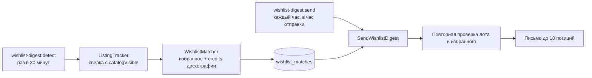

# Корзина и избранное

> Приоритет: **P0** (корзина). Актуально на 2026-11-04.

## Назначение

Серверная корзина и полиморфное избранное (товар / релиз / артист / лейбл / мастер). Для гостя корзина и избранное живут в `localStorage` и сливаются в аккаунт при входе.

## Endpoints

| Метод | Путь | Контроллер | Назначение |
|---|---|---|---|
| `GET`/`POST`/`PATCH`/`DELETE` | `/api/cart[...]` | `Api\CartController` | Корзина — см. [checkout](/processes/checkout#корзина-участвует-в-оформлении) |
| `POST` | `/api/cart/merge` | `merge()` | Слияние гостевой корзины |
| `GET` | `/api/wishlist/{type}` | `Api\FavoriteController` | Избранное по типу |
| `POST`/`DELETE` | `/api/wishlist/{type}/{id}` | — | Добавить / удалить |
| `GET` | `/api/wishlist/{type}/{id}/check` | — | Проверить статус |

## Письма о появлении товаров

Покупатель получает суточную подборку, когда в продаже появляется лот, совпавший с товаром, релизом, мастер-релизом, артистом или лейблом из избранного. Мгновенные уведомления на сайте и в мессенджерах по-прежнему идут только по релизу (`NotifyWishlistReleaseAvailable`), письмом они не дублируются.

**Появление лота.** `product_listing_states` сравнивается с `Product::catalogVisible()`, а не со событиями модели: остаток, ПВЗ и гейт продавца меняются и в обход Eloquent. Текущая витрина записана миграцией и новинкой не считается.

| Событие | Письмо |
|---|---|
| Лот впервые появился на витрине | Да |
| Лот вернулся позже окна повторной активации (24 ч) | Да, если о нём ещё не писали |
| Лот вернулся в пределах окна, в том числе после отмены заказа | Нет |
| Лот на витрине привязали к релизу, включая «Заполнить дискографию» | Да, для подписчиков релиза, артиста и лейбла |
| Черновик, правка, цена, количество | Нет: видимость не меняется |
| Первый показ лота с `legacy_id` | Нет |
| Рассылка выключена | Нет, очередь не копится |

**Сопоставление.** Артисты, лейблы и мастер приходят из `POST /api/disco/match/credits`, в main их нет. Если дискография недоступна, лоты остаются в очереди до следующего запуска. Лоты без `release_id` совпадают только с избранным товаром. На пару «пользователь + лот» одна запись (`unique`), при нескольких совпадениях берётся самая точная: товар → релиз → мастер → артист → лейбл. Об одном лоте письмо приходит один раз.

**Перед письмом** повторно проверяются витрина, наличие объекта в избранном, `favorites.notify` и настройки пользователя. Недоступный лот становится `skipped` и вернётся при следующем появлении, снятый из избранного — `cancelled`. Письмо получают только активные пользователи с подтверждённой настоящей почтой.

**Выключатели.** На объект — `favorites.notify` (по умолчанию включено), на весь раздел — `wishlist_email`, та же настройка, что в профиле. Отписка из письма работает без входа: страница `/wishlist/unsubscribe/{token}` и заголовок `List-Unsubscribe-Post`. По GET письма не отключаются, потому что почтовые сканеры открывают ссылки сами.

**Аналитика.** Раздел `/admin/wishlist-digests` (права `wishlist-digest.view` и `.manage`): воронка, журнал, повтор писем со сбоем, настройки. Ссылки письма ведут через редирект main и получают UTM `utm_source=muzilla&utm_medium=email&utm_campaign=wishlist_digest`. Корзина и оплаченный заказ засчитываются, если этот пользователь переходил на этот товар за последние 7 дней.

Ограничения: «отправлено» означает, что письмо принял SMTP, возвраты не видны. Открытия считаются пикселем и примерны, почтовые сканеры могут завышать открытия и переходы. Сбой отправки автоматически не повторяется, письмо переотправляется из админки.

| Метод | Путь | Назначение |
|---|---|---|
| `PATCH` | `/api/wishlist/{type}/{id}/notify` | Письма по объекту |
| `GET` | `/api/wishlist/new-arrivals` | Новинки за 30 дней, страница `/wishlist/new` |
| `GET` | `/api/public/wishlist-digest/{token}/click/{product}`, `/go/{target}`, `/open.gif` | Ссылки и пиксель письма |
| `GET`/`POST` | `/api/public/wishlist-digest/{token}/subscription`, `/unsubscribe`, `/subscribe` | Отписка без входа |
| `GET`/`PUT`/`POST` | `/api/admin/wishlist-digests[...]` | Журнал, сводка, настройки, повтор |

## Как тестировать

**Покрытие:** 🔴 Cart API — **0** (критический пробел, P0); избранное — 74 фронт-теста (`nuxt/tests`); письма о появлении товаров — `tests/Feature/Wishlist/WishlistDigestTest.php`. Ключевые проверки: гостевая корзина → merge, галочки выбора (`deselectedItemIds`), полиморфное избранное без auth (гостевые сердечки). См. [матрицу](/testing/coverage-matrix).

## Ключевые файлы

| Область | Файл |
|---|---|
| Контроллеры | `app/Http/Controllers/Api/{CartController,FavoriteController}.php` |
| Сервис | `app/Services/FavoriteService.php` |
| Рассылка | `app/Services/WishlistDigest/*`, `app/Jobs/SendWishlistDigest.php`, `resources/views/emails/wishlist/digest.blade.php` |
| Модели | `app/Models/{CartItem,Favorite}.php` (Favorite — полиморфный), `app/Models/{ProductListingState,WishlistMatch,WishlistDigest,WishlistDigestEvent}.php` |
| Frontend | `nuxt/stores/{cart,wishlist}.ts`, `nuxt/pages/cart.vue`, `nuxt/pages/wishlist/*`, `nuxt/pages/admin/wishlist-digests/index.vue` |
| Хранилище гостя | `localStorage` (`useGuestCart`, гостевое избранное) |

